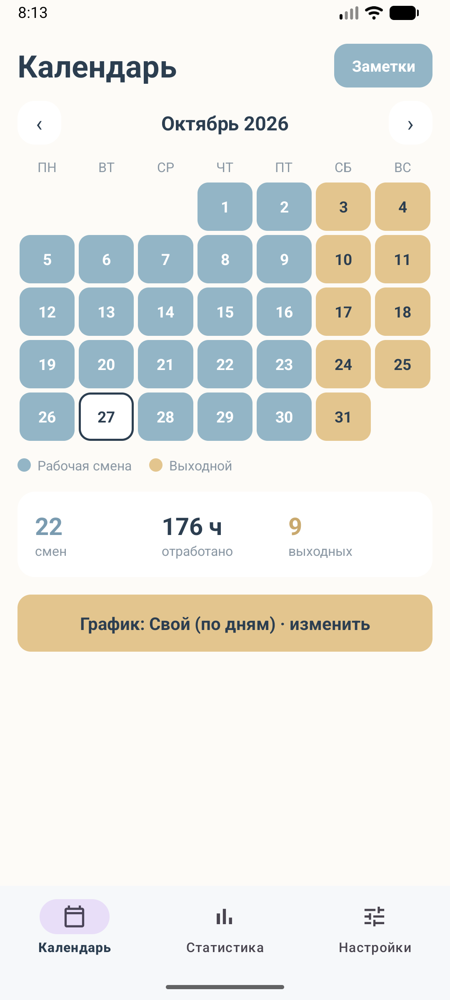
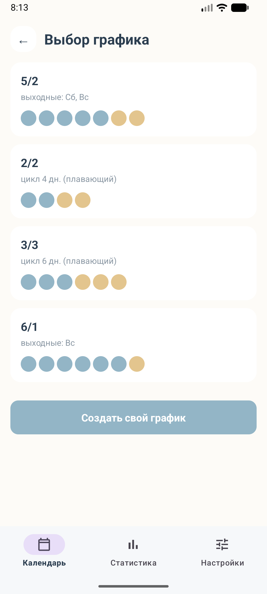
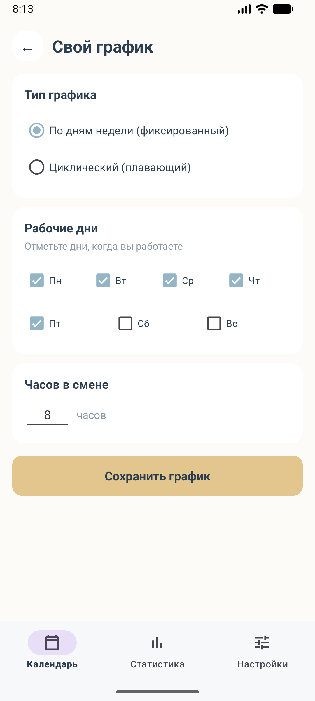
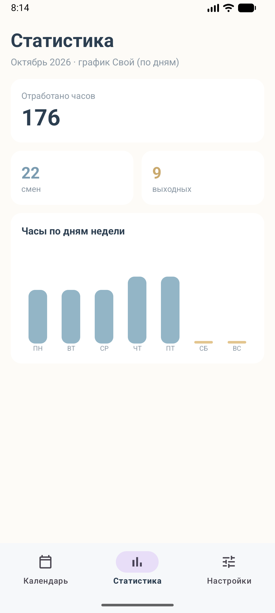
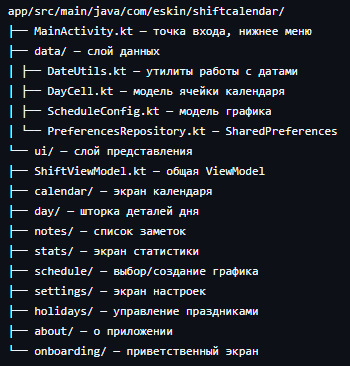

# ShiftCalendar

Мобильное приложение для Android, позволяющее учитывать рабочие и выходные дни при сменном графике работы. Разработано в рамках лабораторной работы №2.

## Описание идеи

ShiftCalendar — это приложение для работников со сменным графиком, которым сложно ориентироваться в стандартном календаре. Пользователь выбирает один из готовых графиков (5/2, 2/2, 3/3, 6/1) или настраивает собственный, и приложение автоматически раскрашивает календарь: рабочие дни отмечены мягким синим цветом, выходные — песочно-жёлтым. Поддерживаются государственные праздники РФ, заметки к конкретным дням, ручные переопределения статуса дня и детальная статистика отработанных часов.

Основной поток пользователя: запуск → выбор графика → просмотр раскрашенного календаря → тап по дню для добавления заметки или изменения статуса → просмотр статистики.

## Дизайн-макет

Интерактивный прототип в Pixso: [ссылка на макет]([https://ваша-ссылка-на-pixso](https://pixso.net/app/design/9Aq5FrND52pDUlghZjuVcw?icon_type=1&page-id=0%3A1))

Цветовая палитра:
- Мягкий синий `#93B5C6` — рабочие дни
- Песочно-жёлтый `#E3C58E` — выходные дни
- Кремовый `#FDFBF7` — фон
- Тёмно-серый `#2C3E50` — текст

## Возможности

- 4 готовых графика с превью-паттернами (5/2, 2/2, 3/3, 6/1)
- Создание собственного графика:
  - По дням недели (фиксированный)
  - Циклический (плавающий) с выбором даты первой смены
- Интерактивный календарь с цветовой кодировкой
- Шторка деталей дня (BottomSheet) с заметками и ручным переопределением
- Государственные праздники РФ (с возможностью добавлять свои)
- Список всех заметок с возможностью редактирования
- Статистика: смены, часы, распределение по дням недели
- Сохранение данных между запусками (SharedPreferences)
- Архитектура MVVM (ViewModel + LiveData)

## Стек технологий

- Kotlin 1.9+
- Android Studio Rabbit 2026.x
- Min SDK: API 24 (Android 7.0)
- Target SDK: API 34
- Архитектура: MVVM
- Navigation Component (Fragment-based)
- ViewBinding
- SharedPreferences для хранения данных
- Material Design 3

## Установка

### Вариант 1: Из APK
1. Скачайте файл `app-debug.apk` из корня репозитория
2. Перенесите файл на устройство Android
3. Разрешите установку из неизвестных источников
4. Установите APK

### Вариант 2: Сборка из исходников
1. Клонируйте репозиторий: `git clone https://github.com/ВАШ_ЛОГИН/shiftcalendar.git`
2. Откройте проект в Android Studio Rabbit
3. Дождитесь синхронизации Gradle
4. Запустите на эмуляторе или физическом устройстве

### Требования
- Android 7.0 (API 24) и выше
- ~30 МБ свободного места

## Скриншоты

| Календарь | Выбор графика | Свой график | Статистика |
|-----------|---------------|-------------|------------|
|  |  |  |  |

## Структура проекта

## Реализованные экраны (10+)

1. Онбординг (первый запуск)
2. Календарь (главный экран)
3. Статистика
4. Настройки
5. Выбор графика
6. Свой график
7. Шторка деталей дня (BottomSheet)
8. Список заметок
9. Праздники
10. О приложении

## Лицензия

Учебный проект. Свободное использование.
